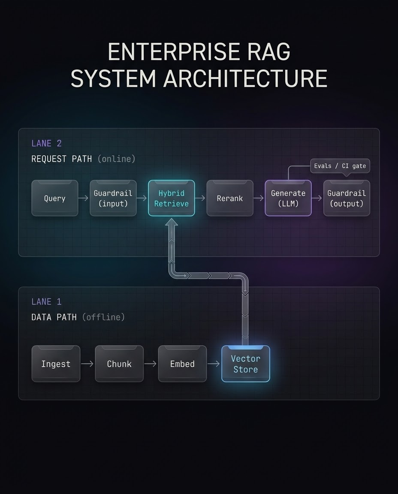

# rag-system

[](https://github.com/Mehtabk/rag-system/actions/workflows/ci.yaml)
[](./LICENSE)
[](https://www.python.org/)

**A reference implementation of production RAG architecture** — the structure around the
model, not another model wrapper. Runs end-to-end with zero API keys, so you can read the
architecture by running it.

> Most RAG systems don't fail on the model. They fail on the structure around it. This repo
> is that structure, made explicit and runnable.

## Architecture

Two **decoupled paths** that share one vector store — the central idea of the design:

- **Data path** (offline): `ingest → chunk → embed → store`
- **Request path** (online): `query → input guardrail → hybrid retrieve → rerank → generate → output guardrail`



Design principles it encodes (drawn from the 2026 production-RAG consensus):

- **Hybrid retrieval** — dense vectors (semantic) fused with sparse keyword scoring, then a
  reranking stage before generation.
- **Guardrails as code-path gates** — input screening (PII / injection) *before* retrieval,
  and an output grounding check *before* an answer is returned. A gate, not a prompt line.
- **First-class evals** — `evals/` is a peer to `tests/`: retrieval + answer metrics wired
  into a CI regression gate that fails the build when quality drops.
- **Everything behind interfaces** — each stage (embeddings, vector store, reranker,
  generation) is swappable via config, so providers change without touching callers.

## Maturity: reference skeleton, honestly scoped

This is a **runnable reference implementation**, not a deployed product. It ships
dependency-free placeholders so it works offline out of the box; real backends plug into
the same interfaces. Here is exactly what is implemented vs. stubbed:

| Stage | Shipped & working | Interface ready (stub provided) |
|-------|-------------------|---------------------------------|
| Embeddings | `hashing` (no deps), `local` (sentence-transformers, offline) | `openai` |
| Vector store | `memory` (in-memory, JSON-persisted) | `pinecone`, `pgvector`, `qdrant` |
| Reranker | `identity` (passthrough) | `cohere`, cross-encoder |
| Generation | `echo` (deterministic, extractive) | `anthropic`, `openai` |
| Ingestion | `.txt` / `.md` directory loader | PDF / HTML / CSV, layout-aware parsing |
| Guardrails | input (PII/injection) + output (lexical grounding) | NLI/LLM-based faithfulness judge |
| Observability | span timing stub | OpenTelemetry spans, `/metrics`, token-cost |

See the [Roadmap](#roadmap) for what turns this from a skeleton into a deployable system.

## Quickstart

```bash
pip install -e ".[dev]"        # install (editable, with dev tools)
make ingest                    # data path: index the sample corpus
make serve                     # request path: API at http://localhost:8000/docs
make eval                      # eval harness + regression gate
make test                      # unit + integration tests
```

Ask a question once the server is running:

```bash
curl -s -X POST http://localhost:8000/query \
  -H 'content-type: application/json' \
  -d '{"question": "What is hybrid retrieval?"}' | python3 -m json.tool
```

## Project layout

```
config/            models, chunk sizes, top_k, prompts, logging — centralized, env-overridable
src/rag/
  ingestion/       source loaders + the offline index run            ─┐ data path
  chunking/        recursive splitter + chunk metadata                │
  embeddings/      embedder interface + providers/ (hashing, local)   │
  vectorstore/     store interface + providers/ (in-memory)          ─┘
  retrieval/       hybrid search (vector + keyword) + rerank + router ─┐ request path
  generation/      llm interface + providers/ + prompt assembly        │
  guardrails/      input (PII/injection) + output (grounding) gates    │
  pipelines/       index_pipeline.py / query_pipeline.py wire it up   ─┘
  api/             FastAPI app, routes, pydantic schemas, security
  observability/   span-timing stub (OTel-ready)
  settings.py      env-driven runtime/security settings (secrets, CORS, limits)
  config.py        YAML config loader with env overrides
evals/             golden dataset, metrics, eval runner, CI regression gate
tests/             unit + integration
scripts/           reindex
```

## Configuration

Two layers, by design:

- **`config/config.yaml`** — non-secret tuning (providers, chunk size, `top_k`, thresholds).
  Safe to commit.
- **Environment (`RAG_*`, see `.env.example`)** — secrets and operational/security settings
  (API keys, CORS, rate limits, admin token). Never committed.

Selected values accept env overrides (e.g. `RAG_EMBEDDINGS_PROVIDER`) so CI can pin the
dependency-free embedder while real use defaults to a semantic model.

## Choosing an embedder

Swappable via `config/config.yaml` (`embeddings.provider`). The repo default is `local`
(offline semantic); CI pins `hashing` for speed.

| Provider | Config value | Deps | API key | Quality | Use when |
|----------|--------------|------|---------|---------|----------|
| Hashing  | `hashing`    | none | no  | low (lexical) | CI, unit tests, zero-footprint demos |
| Local    | `local`      | `.[local]` (torch) | no | good (semantic) | offline dev, privacy-sensitive, no API budget |
| OpenAI   | `openai`     | `.[providers]` | yes | best | once the provider stub is implemented |

```bash
pip install -e ".[local]"      # enable the offline semantic model
python scripts/reindex.py      # re-embed the corpus after any embedder change
```

> Changing the embedder changes vector dimensionality — **always reindex** after a switch.
> A store built with one model cannot be searched with another.

## Security

Hardened defaults, all configurable via `RAG_*` env vars (see `.env.example`):

- **Deny-by-default CORS** — opt specific origins in via `RAG_CORS_ORIGINS`.
- **Docs off in production** — `/docs`, `/redoc`, `/openapi.json` disabled unless `RAG_ENABLE_DOCS=true`.
- **Per-IP rate limiting** (`RAG_RATE_LIMIT_*`) → `429` on abuse.
- **Security headers** on every response (`X-Content-Type-Options`, `X-Frame-Options`, CSP, HSTS over TLS).
- **Bounded input** — questions over `RAG_MAX_QUESTION_CHARS` rejected with `422`.
- **Admin-gated `/ingest`** — requires `X-Admin-Token` (constant-time compared); **fail-closed** in production when no token is set.
- **Guardrails** — input injection/PII screening before retrieval; output grounding check before an answer ships.
- **Generic 500s** — internal errors logged server-side, never leaked to clients.
- **Secrets from env only** (`SecretStr`), never logged; `.env` is gitignored.
  Generate an admin token: `python -c "import secrets; print(secrets.token_urlsafe(32))"`.
- **Defensive I/O** — oversized files skipped, symlinks escaping the ingestion root refused, corrupted index degrades to empty.

## Swapping in a real provider

Each pluggable stage exposes an abstract interface and a `providers/` folder with a
commented stub showing where a real backend plugs in:

| Stage        | Interface                | Add a provider at              |
|--------------|--------------------------|--------------------------------|
| Embeddings   | `embeddings/embedder.py` | `embeddings/providers/`        |
| Vector store | `vectorstore/base.py`    | `vectorstore/providers/`       |
| Generation   | `generation/llm.py`      | `generation/providers/`        |

Implement the interface, add the branch to the stage's factory, point `config.yaml` at it —
nothing else changes.

## Roadmap

From reference skeleton toward deployable system:

- [ ] Real provider pair (OpenAI embeddings + Anthropic generation) behind the stubs
- [ ] Persistent vector store (pgvector / Qdrant)
- [ ] Cross-encoder reranker
- [ ] Streaming responses + embedding/retrieval caching
- [ ] OpenTelemetry tracing + `/metrics` + token-cost accounting
- [ ] Permission-aware (metadata-filtered) retrieval for multi-tenant use
- [ ] PDF / HTML / CSV loaders with layout-aware parsing

For enterprise scale, the index and request paths split into separately deployed services
behind an async queue, with multi-tenant isolation, a caching tier, and permission-aware
retrieval.

## License

MIT — see [LICENSE](./LICENSE). Built by [DeeplyAgentic](https://www.deeplyagentic.com).
